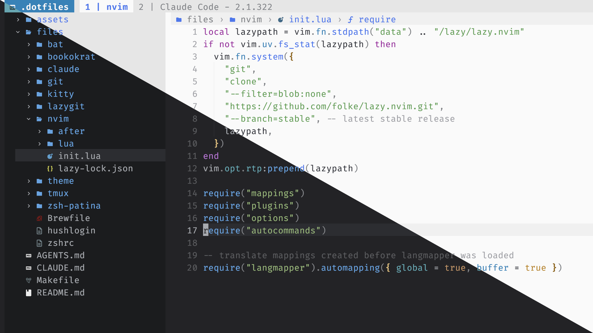

<h1 align="center">dotfiles</h1>

<p align="center">
  Конфиги для macOS: kitty, zsh, tmux, neovim, lazygit и delta в одной теме onedark,
  тёмной (warmer) или светлой (light) по команде `theme`.
</p>



## Установка

Нужны macOS и git (появляется после `xcode-select --install`), Homebrew
`make install` поставит сам.

```sh
git clone https://github.com/tommsawyer/.dotfiles ~/.dotfiles
cd ~/.dotfiles
make install
```

Ставит всё из [`files/Brewfile`](files/Brewfile) — инструменты, LSP-серверы,
шрифт — и линкует конфиги. Плагины nvim скачаются при первом запуске.

## Что настроено

### Редактор: neovim

- **LSP и автодополнение** для Go (с templ-шаблонами), TypeScript, Python,
  Lua, Kotlin, Swift, Ruby, bash, HTML/CSS, YAML и JSON со схемами. Автоформатирование при сохранении.
- **Навигация:** поиск файлов и текста, дерево, хлебные крошки с функцией
  под курсором, прыжки по функциям/условиям/циклам, текстовые объекты по
  дереву синтаксиса.
- **Git в файле:** подсветка изменений и blame строки.
- **Русская раскладка не мешает:** команды и метки flash работают без
  переключения, `:ц` сохраняет файл.

### Git

- Основной инструмент — **lazygit**, в попапе tmux (`C-f g`).
- Диффы рисует **delta**: две колонки на широком экране, подсветка onedark.

### Агентская разработка

- **Claude или opencode** открываются в панели tmux справа от nvim и
  переживают его перезапуск. Из nvim агенту отправляют место под курсором
  или файл, есть готовые промпты: объяснить, ревью файла, допиши код здесь.
- **Меню агентов:** `C-f a` — все агенты во всех сессиях, `C-f A` — сразу
  к тому, кто ждёт ответа, или закончил, а ты ещё не видел.
- Статусы агентов стоят на вкладках, счётчик ждущих — в статус-баре tmux.

### Проекты

- **Один проект — одна сессия tmux.** `tm dotf` открывает сессию по имени,
  пути или истории zoxide, `C-f s` переключает; в списке сверху — прошлая
  сессия, `Enter` возвращает назад.
- **Worktree одной клавишей** (`Ctrl-N`): копия репозитория на своей ветке
  со своей сессией — агента оставил работать, сам вернулся к основному.
  Управление — во вкладке Worktrees в lazygit.

### Kubernetes

- В промпте лениво появляется сегмент ` k3d-dev/payments` — кластер и
  неймспейс: после первой команды с кубом в сессии, перечитывается только
  при смене kubeconfig.
- `k` — kubectl с комплишенами подкоманд, флагов и имён подов; `describe`
  и `get` показываются через bat с подсветкой. Комплишены stern, kubectx
  и k3d тоже на месте.

### Терминал

- **kitty** без заголовка, вкладок и сплитов — их делает tmux.
- Промпт zsh: путь от корня репозитория, код выхода с именем сигнала,
  время выполнения, фоновые задачи.
- zoxide и fzf для навигации, bat, glow, tock — текущая задача tock видна
  в статус-баре tmux.
- **`theme light` / `theme dark`** переключает kitty, tmux и всё консольное
  сразу; nvim и Claude Code нужно перезапустить.

## Устройство репозитория

Конфиги лежат в [`files/`](files), `Makefile` линкует их по списку `LINKS`
и держит остальные цели: `install`, `check`, `fmt`, `nvim-sync`, `clean`.
