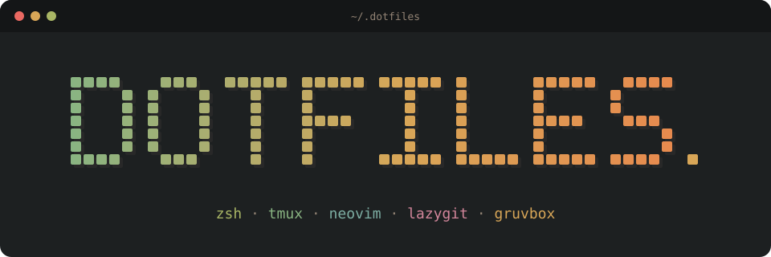
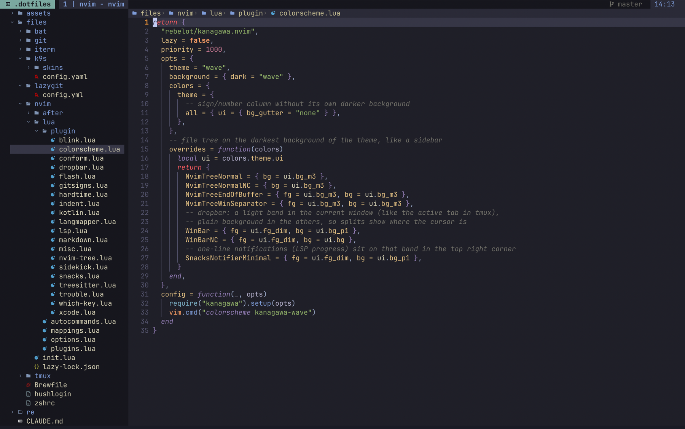

<p align="center">
  
</p>

<p align="center">
  Конфиги для macOS: zsh, tmux, neovim, lazygit, delta и k9s в одной теме kanagawa (wave).
</p>

<p align="center">
  
</p>

## Главное

- **Один проект — одна сессия tmux.** `tm dotf` открывает или создаёт сессию
  по имени, пути или истории zoxide, `C-f s` переключает сессии через fzf.
- **Neovim с минимальным интерфейсом:** без статус-бара и командной строки,
  LSP без Mason, всё ставится через Brewfile.
- **Русская раскладка не мешает.** Команды vim и маппинги работают и в ней,
  `:ц` сохраняет файл.
- **AI-агент рядом с кодом.** Claude или opencode открываются в панели tmux
  справа, и им можно отправить место под курсором или весь файл.
- **Git через lazygit.** Частые команды `git` в терминале подсказывают, как
  сделать то же в lazygit.

## Установка

Нужны macOS и git (он появляется после `xcode-select --install`).
Homebrew `make install` поставит сам, если его ещё нет.

```sh
git clone https://github.com/tommsawyer/.dotfiles ~/.dotfiles
cd ~/.dotfiles
make install
```

`make install` ставит Homebrew и всё из [`files/Brewfile`](files/Brewfile)
(включая шрифт JetBrains Mono Nerd Font), emmet language server, oh-my-zsh и
русский словарь для проверки орфографии. Потом создаёт симлинки на конфиги.

> [!NOTE]
> Если на месте ссылки лежит обычный файл, он переименовывается в `*.backup`.
> Убрать все ссылки можно через `make clean`.

После установки остаются два шага:

1. **iTerm2:** Settings → Profiles → выбрать «Kanagawa» → Other Actions → Set
   as Default. Сам профиль (цвета, шрифт, без меток команд) подключается из
   [`files/iterm/profile.json`](files/iterm/profile.json) как dynamic profile.
   Его guid не меняется, так что это делается один раз.
2. **Neovim:** при первом запуске `nvim` сам ставит плагины.

> [!WARNING]
> `git status`, `commit`, `push` и другие частые команды в терминале не
> выполняются, а печатают, как сделать то же в lazygit. Настоящий git — через
> `command git …` или `GIT_FORCE=1 git …`. Подробнее в разделе
> [lazygit](#lazygit).

## Проекты: tmux

Каждый проект — отдельная сессия tmux, сессия называется по имени папки.
Prefix — `C-f`. Всё, кроме `tm`, настроено в
[`files/tmux/tmux.conf`](files/tmux/tmux.conf). После правок конфиг
перечитывается по `C-f r`.

### Открыть и переключить проект

| Клавиша | Действие |
|---|---|
| `tm` | сессия для текущей папки |
| `tm <имя>` | сессия по имени, пути или слову из zoxide (`tm dotf` → `~/.dotfiles`) |
| `C-f s`, `Ctrl-G` в zsh | fzf со списком сессий и папок из истории zoxide |
| `C-f w` | стандартное дерево сессий |

`tm` создаёт сессию, если её нет. Снаружи tmux команда подключается к сессии,
внутри переключается на неё. По `Tab` дополняются сессии и папки. Функция
объявлена в [`files/zshrc`](files/zshrc), логика лежит в
[`files/tmux/connect.sh`](files/tmux/connect.sh).

В fzf справа показывается превью: `Enter` открывает выбранное, `Ctrl-X`
убивает сессию, новое имя и `Enter` создают сессию. Код в
[`files/tmux/switch.sh`](files/tmux/switch.sh), папки берутся через sesh.

### Окна и панели

| Клавиша | Действие |
|---|---|
| `C-f \` / `C-f -` | разделить окно вбок / вниз |
| `C-f c` | новое окно |
| `C-f h/j/k/l` | перейти между панелями |
| `C-f J` / `C-f b` | присоединить панель / вынести в отдельное окно |
| `C-f !` / `C-f @` | раскладки main-horizontal / even-horizontal |
| `C-f g` / `C-f K` | плавающий lazygit / k9s |

Всё открывается в текущей папке. Окна нумеруются с 1, после закрытия номера
сдвигаются без дыр. Мышь включена. Плавающие панели занимают 90% экрана и
закрываются вместе с программой, для них нужен tmux 3.7+.

### Статус-бар

Стоит сверху. Слева имя сессии, оно желтеет, пока нажат prefix. Дальше окна,
у каждого — что сейчас делает AI-агент (берётся из заголовка его панели).
Справа git-ветка, контекст kubectl и время. Палитра kanagawa записана
комментарием в конфиге. `extended-keys` пропускает `Shift-Enter` и подобные
комбинации в nvim и Claude Code.

## Neovim

Leader — `,`. Если начать комбинацию и подождать полсекунды, which-key покажет
продолжения. Пути ниже даны относительно `files/nvim/`.

### Файлы и поиск

| Клавиша | Действие |
|---|---|
| `<Space>` | поиск файлов |
| `,f` | поиск текста по проекту |
| `,b` / `,h` / `,d` | буферы / help / символы проекта |
| `,,` | открыть или закрыть дерево файлов |
| `,a` | показать текущий файл в дереве |
| `,;` | выбрать элемент хлебных крошек по метке |

- **Поиск** — пикеры snacks.nvim. Что не попадает в поиск, задано списком
  `exclude` в начале [`lua/plugin/snacks.lua`](files/nvim/lua/plugin/snacks.lua).
- **Дерево** — nvim-tree,
  [`lua/plugin/nvim-tree.lua`](files/nvim/lua/plugin/nvim-tree.lua). Если
  открыть его из файла проекта, файл будет подсвечен. Dotfiles, `*_templ.go` и
  `go.sum` скрыты, `H` показывает dotfiles. При переименовании файла LSP
  обновляет импорты.
- **Хлебные крошки** над каждым окном показывают путь к файлу и функцию или
  класс под курсором. В меню `o` открывает папку или файл, `t` показывает его
  в дереве, `a` создаёт файл рядом. В yaml, json и toml вместо символов LSP
  показываются ключи. Плагин dropbar,
  [`lua/plugin/dropbar.lua`](files/nvim/lua/plugin/dropbar.lua).
- **Открытие и перечитывание.** `nvim` без аргументов открывает последний
  файл, который правили в этом проекте, курсор встаёт на прежнее место. Если
  файл изменился на диске (например, его поправил агент), nvim перечитывает
  его. Это [`lua/autocommands.lua`](files/nvim/lua/autocommands.lua).

### Перемещение

| Клавиша | Действие |
|---|---|
| `<CR>` | прыжок по меткам на экране |
| `r` после оператора | действие в месте по метке без движения курсора (`yr` + метка + `iw` копирует слово) |
| `S` | выделить узел treesitter |
| `af`/`if`, `ai`/`ii`, `al`/`il` | функция, условие, цикл |
| `aa`/`ia`, `ac`/`ic`, `as` | параметр, вызов, выражение |
| `]f` `[f`, `]i` `[i`, `]l` `[l`, `]c` `[c` | к следующей / предыдущей функции, условию, циклу, вызову |
| `]=` `[=` | к строке с другим отступом |
| `]-` `[-` | к строке с меньшим отступом (выход из блока) |
| `a=`/`i=` | блок по отступу |
| `<C-h/j/k/l>` | в соседнее окно, а если его нет — новый сплит |

- Прыжки по меткам — flash,
  [`lua/plugin/flash.lua`](files/nvim/lua/plugin/flash.lua). При поиске через
  `/` метки тоже появляются на совпадениях.
- Текстовые объекты по структуре — treesitter-textobjects,
  [`lua/plugin/treesitter.lua`](files/nvim/lua/plugin/treesitter.lua). Там же
  список парсеров. Подсветку HTML внутри Go-шаблонов задаёт
  `after/queries/gotmpl/injections.scm`.
- Прыжки по отступам, окна и то, что `{` и `}` не засоряют jumplist, — в
  [`lua/mappings.lua`](files/nvim/lua/mappings.lua). Блок по отступу — scope
  из snacks, линии отступов рисует indent-blankline
  ([`lua/plugin/indent.lua`](files/nvim/lua/plugin/indent.lua)).

### LSP

| Клавиша | Действие |
|---|---|
| `K` | документация |
| `gd` | определение |
| `grn` | переименование |
| `ga` | code action |
| `]d` `[d` | следующая / предыдущая диагностика |
| `grr` | ссылки |
| `gri`, `gi` | реализации |
| `grt`, `gy` | типы |
| `gO`, `,s` | символы файла |
| `,t` | все диагностики |

Списки открываются в Trouble
([`lua/plugin/trouble.lua`](files/nvim/lua/plugin/trouble.lua)). Прогресс
запуска серверов показывается уведомлениями в правом верхнем углу.

Серверы описаны в [`lua/plugin/lsp.lua`](files/nvim/lua/plugin/lsp.lua).
Включает их встроенный `vim.lsp.enable` (список в конце файла), а
nvim-lspconfig только поставляет конфиги. Сами серверы ставятся через
Brewfile, Mason не используется. Отдельно настроены:

- gopls — понимает шаблоны;
- jsonls и yamlls — схемы из schemastore, для yaml ещё GitLab CI;
- basedpyright и ruff — basedpyright даёт типы и hover, ruff — линт и импорты;
- lua_ls;
- emmet — работает и в templ.

Чтобы добавить сервер, его нужно добавить в Brewfile, вписать в
`vim.lsp.enable` и при необходимости настроить через `vim.lsp.config`.

**Kotlin и Swift.** Для Kotlin стоит официальный kotlin-lsp,
[`lua/plugin/kotlin.lua`](files/nvim/lua/plugin/kotlin.lua). Для Swift есть
сборка, запуск и тесты на симуляторе: `,xx` открывает меню, `,xb` / `,xr` /
`,xt` — сборка / запуск / тесты
([`lua/plugin/xcode.lua`](files/nvim/lua/plugin/xcode.lua)). Отступ в 4
пробела задан в `after/ftplugin/kotlin.lua` и `swift.lua`.

> [!NOTE]
> В новом Xcode-проекте один раз нужно запустить `:XcodebuildSetup`.

### Автодополнение и форматирование

| Клавиша | Действие |
|---|---|
| `<C-y>` | принять |
| `<C-n>` / `<C-p>` | следующий / предыдущий пункт |
| `<C-space>` | открыть меню |
| `<C-e>` | закрыть меню |

- **Автодополнение** — blink.cmp,
  [`lua/plugin/blink.lua`](files/nvim/lua/plugin/blink.lua). Источники — LSP и
  сниппеты friendly-snippets. Документация к пункту появляется через
  полсекунды, подсказка по аргументам показывается сама.
- **Форматирование** при сохранении — conform,
  [`lua/plugin/conform.lua`](files/nvim/lua/plugin/conform.lua). Форматтеры
  назначены по типам файлов, если форматтера нет, форматирует LSP. Swift
  форматируется, только если в проекте есть `.swift-format`. Импорты Go
  поправляются при сохранении автокомандой в `lsp.lua`.

### Редактирование

| Клавиша | Действие |
|---|---|
| `sa{движение}{символ}` | обернуть текст |
| `sd{символ}` / `sr{старый}{новый}` | убрать / заменить обёртку |
| `gS` / `gJ` | разбить блок на строки / склеить обратно |
| `gc` | закомментировать (встроено в nvim) |

Обёртки — nvim-surround, скобки сами закрывает nvim-autopairs, оба в
[`lua/plugin/misc.lua`](files/nvim/lua/plugin/misc.lua). Разбивку блоков
делает treesj, а парные HTML-теги закрывает и переименовывает nvim-ts-autotag,
оба в `treesitter.lua`. Комментарий не продолжается на новой строке, это
задано в `autocommands.lua`.

### Git

| Клавиша | Действие |
|---|---|
| `]g` `[g` | следующий / предыдущий ханк |
| `,gp` / `,gu` | показать / откатить ханк |
| `,gb` | blame строки |
| `,go` | открыть файл в браузере |

Ханки и blame — gitsigns,
[`lua/plugin/gitsigns.lua`](files/nvim/lua/plugin/gitsigns.lua), браузер —
snacks gitbrowse. Сам lazygit открывается в tmux по `C-f g`.

### AI-агенты

| Клавиша | Действие |
|---|---|
| `,ii` / `,ic` | показать или скрыть агента / выбрать агента |
| `,ie` | попросить объяснить место под курсором |
| `,is` / `,if` | отправить агенту это место / весь файл |
| `,ip` | готовые промпты на русском |
| `,iw` | «допиши код здесь» |
| `<C-.>` | переключиться между nvim и агентом |

Плагин sidekick, [`lua/plugin/sidekick.lua`](files/nvim/lua/plugin/sidekick.lua).
Агент (claude, opencode, …) открывается в отдельной панели tmux справа и
переживает перезапуск nvim.

### Внешний вид

- Тема kanagawa-wave и её переопределения (дерево, winbar) —
  [`lua/plugin/colorscheme.lua`](files/nvim/lua/plugin/colorscheme.lua).
- Нет ни статус-бара, ни командной строки, мышь выключена. Это и остальные
  опции — в [`lua/options.lua`](files/nvim/lua/options.lua).
- Уведомления (история — `,n`) и zen-режим (`,z`) дают snacks.
- Markdown рендерится прямо в буфере плагином render-markdown,
  [`lua/plugin/markdown.lua`](files/nvim/lua/plugin/markdown.lua). Перенос
  строк и проверка орфографии (ru + en) включены в
  `after/ftplugin/markdown.lua`.
- Подсказки клавиш — which-key,
  [`lua/plugin/which-key.lua`](files/nvim/lua/plugin/which-key.lua).

### Русская раскладка и привычки

- Обычные команды vim работают в русской раскладке через `langmap`, а `:ц` и
  `:й` срабатывают как `:w` и `:q`. Это задано в `options.lua`.
- Маппинги с leader, Ctrl и клавиши плагинов дублирует langmapper,
  [`lua/plugin/langmapper.lua`](files/nvim/lua/plugin/langmapper.lua).
- hardtime не даёт жать `hjkl` много раз подряд и подсказывает движение
  получше, [`lua/plugin/hardtime.lua`](files/nvim/lua/plugin/hardtime.lua).

## Консольные утилиты

Shell — zsh с oh-my-zsh (тема robbyrussell, плагины git, tmux, golang,
docker-compose), всё в [`files/zshrc`](files/zshrc). Настройки только для
этой машины кладутся в `~/.zshcustom`, этого файла в репозитории нет.

### lazygit

Основной способ работать с git. Запускается через `lg` или `C-f g`.
Настройки в [`files/lazygit/config.yml`](files/lazygit/config.yml): цвета
kanagawa, `e` открывает файл в nvim. Диффы рисует delta, при ширине от 140
колонок — в две колонки.

В терминале `git status`, `commit`, `push` и другие частые команды (включая
алиасы вроде `gst`) не выполняются, а печатают, как сделать то же в lazygit.
Этот перехват — функция `git` в `zshrc`. Скрипты и `$(git …)` он не трогает.
Настоящий git вызывается через `command git …` или `GIT_FORCE=1 git …`.

### delta

Pager для git, [`files/git/delta.gitconfig`](files/git/delta.gitconfig).
Подключается в `~/.gitconfig` через `include.path`, это делает
`make symlinks`. Дифф показывается в две колонки, `n` / `N` прыгают между
файлами. Добавленные строки синие, а не зелёные, чтобы лучше отличаться от
красных. Конфликты в стиле `zdiff3`, подсветка синтаксиса — тема kanagawa из
bat.

### k9s

Kubernetes, запускается через `C-f K` или `k9s`. Работает только на чтение:
удалить, отредактировать и убить ничего нельзя. Для разовой правки есть
`k9s --write`. Логи показывают последние 200 строк за 5 минут. Настройки в
[`files/k9s/config.yaml`](files/k9s/config.yaml), скин — в
`files/k9s/skins/kanagawa.yaml`.

### zoxide и fzf

| Клавиша | Действие |
|---|---|
| `z <слово>` | перейти в самую подходящую из посещённых папок |
| `zi` | выбрать папку из списка |
| `Ctrl-T` | вставить путь к файлу |
| `Ctrl-R` | поиск по истории команд |
| `Alt-C` | перейти в папку |

История zoxide нужна и для `tm`, и для `C-f s`. fzf ищет файлы через `rg` с
учётом `.gitignore` и показывает скрытые. Цвета kanagawa заданы в
`FZF_DEFAULT_OPTS` в `zshrc`.

### Прочее

- Тема bat — в [`files/bat/config`](files/bat/config) и
  `themes/kanagawa.tmTheme`, кэш тем пересобирает `make symlinks`.
- `glow` рендерит markdown в терминале.
- Алиасы: `vim` → `nvim`, `rg` всегда с `--hidden`, `coverage` запускает
  `go test` и открывает HTML-отчёт о покрытии.
- Полный список программ — в [`files/Brewfile`](files/Brewfile).

## Устройство репозитория

### Цели make

| Цель | Что делает |
|---|---|
| `make install` | Homebrew, Brewfile, emmet, oh-my-zsh, симлинки, настройки iTerm2, словарь |
| `make symlinks` | создаёт ссылки на конфиги (список — `LINKS` в [`Makefile`](Makefile)) |
| `make check` | быстрые проверки: zsh, tmux, shellcheck, yaml, lua-language-server, запуск nvim |
| `make fmt` | форматирует Lua через lua_ls, так же, как при сохранении в nvim |
| `make nvim-sync` | обновляет плагины nvim без интерфейса (`Lazy! sync`, пишет `lazy-lock.json`) |
| `make clean` | удаляет ссылки и подключение delta в `~/.gitconfig` |

### Что куда линкуется

| Файл | Ссылка |
|---|---|
| `files/zshrc` | `~/.zshrc` |
| `files/hushlogin` | `~/.hushlogin` (убирает «Last login») |
| `files/tmux` | `~/.config/tmux` |
| `files/nvim` | `~/.config/nvim` |
| `files/bat` | `~/.config/bat` |
| `files/lazygit/config.yml` | `~/Library/Application Support/lazygit/config.yml` |
| `files/k9s/config.yaml`, `skins/kanagawa.yaml` | `~/Library/Application Support/k9s/` |
| `files/iterm/profile.json` | `~/Library/Application Support/iTerm2/DynamicProfiles/dotfiles.json` |
| `files/git/delta.gitconfig` | подключается из `~/.gitconfig` |

### Как устроен конфиг nvim

[`init.lua`](files/nvim/init.lua) ставит lazy.nvim и подключает модули по
порядку: `mappings` → `plugins` → `options` → `autocommands`. В конце
langmapper переводит на русскую раскладку маппинги, созданные раньше него.
[`lua/plugins.lua`](files/nvim/lua/plugins.lua) загружает все файлы из
`lua/plugin/`: один плагин — один файл, новый плагин — новый файл там же.
Версии плагинов зафиксированы в `lazy-lock.json` и обновляются через
`make nvim-sync`.

### Правка конфигов

После любой правки нужно запустить `make check`, после правки Lua — сначала
`make fmt`.
